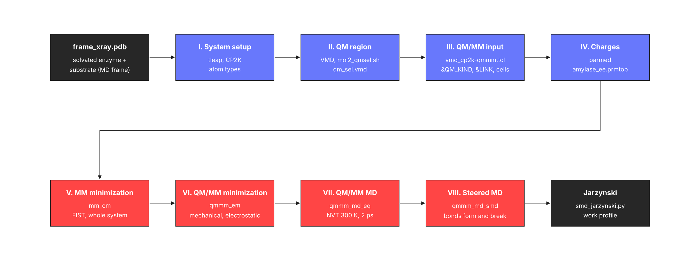

 

<b>This tutorial prepares, step by step, a QM/MM model of an enzyme-substrate complex for CP2K and takes it all the way to a reactive simulation: starting from a PDB frame, it builds the Amber topology with tleap, makes it readable by CP2K, defines the QM region and the &QMMM sections, corrects the MM charges for electrostatic embedding, minimizes and equilibrates the system with QM/MM, and ends with a steered QM/MM MD run in which the glycosidic bond of the substrate breaks, followed by a Jarzynski analysis of the work done along the pull.</b>

Most of the information here came from the <a href="https://www.cp2k.org/" target="_blank">CP2K site</a>, the <a href="https://manual.cp2k.org/" target="_blank">CP2K manual</a>, the <a href="https://ambermd.org/tutorials/" target="_blank">Amber tutorials</a>, the <a href="https://groups.google.com/g/cp2k" target="_blank">CP2K discussion group</a> and the BioExcel QM/MM material listed at the bottom of this page. You should also follow the good practices found in the literature for the specific chemistry of your system.

 

    

 

---

 

<h3>
<b> Example system </b>
</h3>

All the commands, inputs and outputs of the tutorial come from a worked example: human pancreatic &alpha;-amylase (HPA), a retaining glycoside hydrolase of family GH13, with a maltopentaose chain bound in the active site. In retaining &alpha;-amylases the first step of the reaction (glycosylation) breaks the &alpha;-1,4 glycosidic bond between the sugar in subsite -1 and the one in subsite +1: the general acid/base (Glu233 in HPA) protonates the glycosidic oxygen, the nucleophile (Asp197) attacks the anomeric carbon of the -1 sugar and a third carboxylate (Asp300) binds the hydroxyl groups of that sugar. The structure starts at Tyr2, so these residues are Asp196, Glu232 and Asp299 in the topology, and Glu232 is protonated (GLH) to act as the acid.

The model is a frame of a classical MD simulation of the solvated complex (frame_xray.pdb): 67 992 atoms in an orthorhombic box of 90.8 x 103.3 x 91.2 &Aring;, with 20 076 TIP3P water molecules, one Ca2+, one Cl- and one Na+ ion. The protein is described with ff14SB and the oligosaccharide with GLYCAM_06j-1 (residues ROH, 4GA and 0GA, numbered 498 to 503 in the topology). The QM region has 65 atoms (PBE/DZVP, GPW) and the steered MD drives the collective variable CV = d(O4-C1) - d(HGlu232-O4) from -2 to +2 &Aring; in 2 ps.

The steps are general and apply to any enzyme-substrate complex parameterized with Amber-type force fields. Replace the residue numbers, atom numbers and file names with those of your system.

 

<h3>
<b> Requirements </b>
</h3>

- 
<a href="https://ambermd.org/AmberTools.php" target="_blank">AmberTools</a> (tleap and ParmEd). The example was prepared with AmberTools25.

- 
<a href="https://www.cp2k.org/" target="_blank">CP2K</a> compiled with MPI (cp2k.psmp), with its data directory (BASIS_SET, POTENTIAL and MM_POTENTIAL files) reachable through CP2K_DATA_DIR. The example was run with CP2K 2023.1 on 64 (MM) and 128 (QM/MM) MPI ranks; each QM/MM MD step took about 10 s.

- 
<a href="https://www.ks.uiuc.edu/Research/vmd/" target="_blank">VMD</a> to look at the structures and trajectories and to build the &QMMM include files.

- 
Python 3 with ParmEd, NumPy and matplotlib (pip install parmed numpy matplotlib) for the Python scripts, and bash for the shell scripts.

 

<h3>
<b> Repository </b>
</h3>

Each step of the tutorial has its own directory, with the inputs and the outputs of the example. The files that several CP2K runs read (topologies and include files) are kept once, in system_prep, and the restart files are kept in the directory of the run that wrote them; <a href="https://github.com/arvpinto/enzyme_qmmm_prep_cp2k/blob/main/scripts/run_cp2k.sh" target="_blank">run_cp2k.sh</a> copies them where each run needs them.

| Directory | Content |
| :--- | :--- |
| <a href="https://github.com/arvpinto/enzyme_qmmm_prep_cp2k/tree/main/system_prep" target="_blank">system_prep</a> | Sections I to IV: frame_xray.pdb, leap_amyl.in, the three topologies (amylase_prep, amylase, amylase_ee), frame_xray.rst7, the QM selection and the CP2K include files |
| <a href="https://github.com/arvpinto/enzyme_qmmm_prep_cp2k/tree/main/mm_em" target="_blank">mm_em</a> | Section V: MM minimization (mm_em.inp, mm_em.out, MM_EM-1.restart) |
| <a href="https://github.com/arvpinto/enzyme_qmmm_prep_cp2k/tree/main/qmmm_em" target="_blank">qmmm_em</a> | Section VI: QM/MM minimizations with mechanical (qmmm_em_me) and electrostatic (qmmm_em_ee) embedding |
| <a href="https://github.com/arvpinto/enzyme_qmmm_prep_cp2k/tree/main/qmmm_md_eq" target="_blank">qmmm_md_eq</a> | Section VII: QM/MM MD at 300 K (qmmm_md_eq) |
| <a href="https://github.com/arvpinto/enzyme_qmmm_prep_cp2k/tree/main/qmmm_md_smd" target="_blank">qmmm_md_smd</a> | Section VIII: steered QM/MM MD (qmmm_md_smd) and its Jarzynski analysis |
| <a href="https://github.com/arvpinto/enzyme_qmmm_prep_cp2k/tree/main/scripts" target="_blank">scripts</a> | The scripts below |

 

| Script | Description |
| :--- | :--- |
| <a href="https://github.com/arvpinto/enzyme_qmmm_prep_cp2k/blob/main/scripts/prmtop_fix_types.py" target="_blank">prmtop_fix_types.py</a> | Checks the atom types of a prmtop against the way CP2K reads them, and renames those that would be merged or misread |
| <a href="https://github.com/arvpinto/enzyme_qmmm_prep_cp2k/blob/main/scripts/mol2_qmsel.sh" target="_blank">mol2_qmsel.sh</a> | Converts a MOL2 file of the QM region into VMD, PyMOL and Amber mask selections |
| <a href="https://github.com/arvpinto/enzyme_qmmm_prep_cp2k/blob/main/scripts/vmd_cp2k-qmmm.tcl" target="_blank">vmd_cp2k-qmmm.tcl</a> | VMD script that writes the &CELL, &QM_KIND and &LINK include files and the ParmEd script of the charge correction |
| <a href="https://github.com/arvpinto/enzyme_qmmm_prep_cp2k/blob/main/scripts/run_cp2k.sh" target="_blank">run_cp2k.sh</a> | Runs the CP2K stages in order, copying the files each one needs, in place or in a work directory |
| <a href="https://github.com/arvpinto/enzyme_qmmm_prep_cp2k/blob/main/scripts/cp2k_funcs" target="_blank">cp2k_funcs</a> | Bash functions to read CP2K outputs (optimization convergence, MD energies, QM temperature, CV, QM atom serials) |
| <a href="https://github.com/arvpinto/enzyme_qmmm_prep_cp2k/blob/main/scripts/vmd_cp2k-repr.tcl" target="_blank">vmd_cp2k-repr.tcl</a> | VMD script that loads CP2K trajectories and draws the QM region with dynamic bonds |
| <a href="https://github.com/arvpinto/enzyme_qmmm_prep_cp2k/blob/main/scripts/smd_jarzynski.py" target="_blank">smd_jarzynski.py</a> | Work and Jarzynski free energy profile from one or more steered MD runs |
| <a href="https://github.com/arvpinto/enzyme_qmmm_prep_cp2k/blob/main/scripts/plot_smd.py" target="_blank">plot_smd.py</a> | CV, work and selected distances of a steered MD run against time |

 

The CP2K trajectories (*-pos-1.dcd) are too large for the repository and are attached to the <a href="https://github.com/arvpinto/enzyme_qmmm_prep_cp2k/releases/latest" target="_blank">latest release</a>. Each section says which one to download.

<b> Once you have a PDB structure of your enzyme-substrate complex with Amber residue names, you are ready to start this tutorial. </b>

---

### Useful Links:

- <a href="https://manual.cp2k.org/trunk/methods/qm_mm/builtin.html" target="_blank">CP2K manual: QM/MM with the built-in QM/MM driver</a>
- <a href="https://docs.bioexcel.eu/2020_06_09_online_ambertools4cp2k/" target="_blank">Preparing to run biomolecular QM/MM simulations with CP2K using AmberTools</a>
- <a href="https://github.com/bioexcel/cp2K_qmmm_tutorials_for_biological_simulations" target="_blank">QM/MM tutorials adapted to CP2K</a>
- <a href="https://docs.bioexcel.eu/qmmm_simulation_bpg/en/main/index.html" target="_blank">Best Practices in QM/MM Simulation of Biomolecular Systems</a>
- <a href="https://glycam.org/" target="_blank">GLYCAM force field for carbohydrates</a>
- <a href="https://arvpinto.github.io/enzyme_neb_cp2k/" target="_blank">Tutorial for TS searches of enzymatic reaction mechanisms using QM/MM methods in CP2K</a>
