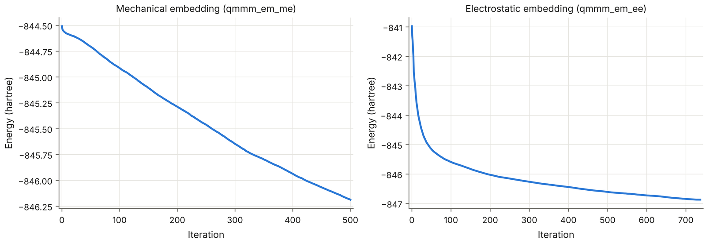

 
<h2> 
 <b>VI - QM/MM minimization: mechanical, then electrostatic embedding</b> 
</h2>

 

<pre style="color: white; background-color: black;">
MM_EM-1.restart  ->  qmmm_em_me.inp (ECOUPL NONE, amylase.prmtop)  ->  qmmm_em_ee.inp (ECOUPL GAUSS, amylase_ee.prmtop)  ->  QMMM_EM_EE-1.restart + QMMM_EM_EE-RESTART.wfn
</pre>

---

 

The MM-minimized structure is relaxed with the QM/MM Hamiltonian in two steps. The first uses mechanical embedding, where the SCF starts from scratch and is cheap and robust; its wavefunction is then the starting guess of the second, with electrostatic embedding, which gives the structure and the wavefunction from which the QM/MM MD starts. Both runs are in <a href="https://github.com/arvpinto/enzyme_qmmm_prep_cp2k/tree/main/qmmm_em" target="_blank">qmmm_em</a>.

 

<h3> 
<b> The QM part </b>
 </h3>

 

<pre style="color: white; background-color: black;">
&FORCE_EVAL
  METHOD QMMM
  STRESS_TENSOR ANALYTICAL
  &DFT
    BASIS_SET_FILE_NAME BASIS_SET
    CHARGE -2
    MULTIPLICITY 1
    POTENTIAL_FILE_NAME POTENTIAL
    UKS FALSE
    &MGRID
      COMMENSURATE  ! mandatory to use GEEP
      CUTOFF 300    ! Default value: 2.80000000E+002
    &END MGRID
    &QS
      METHOD GPW
    &END QS
    &SCF
      EPS_SCF 1E-6
      MAX_SCF 60
      SCF_GUESS ATOMIC
      &OT
        MINIMIZER DIIS
        PRECONDITIONER FULL_SINGLE_INVERSE
        SAFE_DIIS TRUE
      &END OT
      &OUTER_SCF
        EPS_SCF 1E-6
        MAX_SCF 30
      &END OUTER_SCF
    &END SCF
    &XC
      DENSITY_CUTOFF 1.0E-10
      GRADIENT_CUTOFF 1.0E-10
      &XC_FUNCTIONAL PBE
      &END XC_FUNCTIONAL
    &END XC
  &END DFT
  ...
  &SUBSYS
    ...
    &KIND C
      BASIS_SET DZVP-GTH-PBE
      POTENTIAL GTH-PBE-q4
    &END KIND
    &KIND O
      BASIS_SET DZVP-GTH-PBE
      POTENTIAL GTH-PBE-q6
    &END KIND
    &KIND H
      BASIS_SET DZV-GTH-PBE
      POTENTIAL GTH-PBE-q1
    &END KIND
  &END SUBSYS
</pre>

 

- 
The QM region is described with PBE, double-zeta Gaussian basis sets (DZVP for C and O, DZV for H) and GTH pseudopotentials, with the GPW method and a plane-wave cutoff of 300 Ry for the density. CHARGE -2 and MULTIPLICITY 1 are those of the QM region (Section II). BASIS_SET and POTENTIAL are the files distributed in the data directory of CP2K.

- 
The SCF uses the orbital transformation method (OT) with DIIS and the FULL_SINGLE_INVERSE preconditioner, with an outer loop for robustness. In the mechanical embedding run the guess is ATOMIC; every later run reads the wavefunction of the previous one (SCF_GUESS RESTART and WFN_RESTART_FILE_NAME), which saves many SCF steps.

- 
COMMENSURATE makes the multigrids of the QM cell commensurate with each other, which the GEEP treatment of the QM/MM electrostatics needs.

- 
PBE has no dispersion, so it is missing within the QM region (the QM-MM van der Waals interactions come from the Lennard-Jones terms of the force field). For production work consider PBE-D3 (&XC/&VDW_POTENTIAL) or a hybrid functional, and test the basis set and the cutoff on the energies you are interested in.

 

---

 

<h3> 
<b> The &QMMM section and the two runs </b>
 </h3>

 

Mechanical embedding (qmmm_em_me.inp, with amylase.prmtop):

<pre style="color: white; background-color: black;">
  &QMMM
    CENTER EVERY_STEP
    ECOUPL NONE
    USE_GEEP_LIB 6
    @INCLUDE forceeval_qmmm.cp2k.inc
  &END QMMM
</pre>

Electrostatic embedding (qmmm_em_ee.inp, qmmm_md_eq.inp and qmmm_md_smd.inp, with amylase_ee.prmtop):

<pre style="color: white; background-color: black;">
  &QMMM
    CENTER EVERY_STEP
    EPS_MM_RSPACE 1.0E-10
    ECOUPL GAUSS
    MM_POTENTIAL_FILE_NAME MM_POTENTIAL
    PARALLEL_SCHEME ATOM
    SPHERICAL_CUTOFF -5.29177209E-001 0.00000000E+000
    USE_GEEP_LIB 6
    @INCLUDE forceeval_qmmm.cp2k.inc
  &END QMMM
</pre>

 

- 
ECOUPL GAUSS describes each MM point charge as a Gaussian, so that the potential it creates on the QM grid has no singularity, and evaluates it with the Gaussian Expansion of the Electrostatic Potential (GEEP): USE_GEEP_LIB 6 takes an expansion with 6 Gaussians from the library built into CP2K (MM_POTENTIAL, in the data directory, is the file of expansions read when the library is not used). EPS_MM_RSPACE is the accuracy of the real-space part of the expansion and PARALLEL_SCHEME ATOM distributes the MM atoms over the MPI tasks.

- 
A negative SPHERICAL_CUTOFF switches the cutoff off: every MM charge acts on the QM density. The value written here (-0.529 &Aring;) is -1 bohr, as CP2K prints it in a restart file.

- 
The rest of each input (the &MM section, &RESCALE_FORCES and the &TOPOLOGY of &SUBSYS) is that of mm_em.inp, without COORD_FILE_NAME and without the &CELL include: the positions and the cell come from the restart file of the previous step (&EXT_RESTART with RESTART_POS and RESTART_CELL). RESTART_COUNTERS FALSE starts each run from step 0.

 

| | qmmm_em_me.inp | qmmm_em_ee.inp |
| :--- | :--- | :--- |
| ECOUPL | NONE | GAUSS (GEEP, 6 Gaussians) |
| Topology | amylase.prmtop | amylase_ee.prmtop |
| SCF guess | ATOMIC | RESTART (QMMM_EM_ME-RESTART.wfn) |
| Starts from | MM_EM-1.restart | QMMM_EM_ME-1.restart |
| MAX_FORCE / MAX_ITER | 1.2 x 10-3 hartree/bohr / 500 | 4.5 x 10-4 hartree/bohr (default) / 1000 |
| Result in the example | 500 steps, MAX_ITER reached (55 min) | converged after 737 steps (2 h 44 min) |

 

The energies of the two embedding schemes cannot be compared with each other: what matters is that each run behaves as expected. The mechanical embedding run is only a cheap first relaxation of the QM region and its wavefunction, so stopping at MAX_ITER is acceptable there; the electrostatic embedding run ended when the L-BFGS optimizer met its own convergence criteria ("Specific L-BFGS convergence criteria ... satisfied .... run CONVERGED!"), with the maximum gradient at 5.6 x 10-3 hartree/bohr, above MAX_FORCE, and the other three criteria met.

 

---

 

<h3> 
<b> Running and checking the minimizations </b>
 </h3>

 

In the working directory, after the MM minimization (qmmm_em_me.inp reads MM_EM-1.restart, and qmmm_em_ee.inp reads the restart and wavefunction files of qmmm_em_me.inp):

<pre style="color: white; background-color: black;">
cp ../enzyme_qmmm_prep_cp2k/qmmm_em/{qmmm_em_me.inp,qmmm_em_ee.inp} .
cp2k.psmp -i qmmm_em_me.inp -o qmmm_em_me.out
cp2k.psmp -i qmmm_em_ee.inp -o qmmm_em_ee.out
</pre>

As in Section V, put mpirun -np N (or srun) in front of each command to run in parallel; the example used 128 MPI ranks. The outputs of the example are in <a href="https://github.com/arvpinto/enzyme_qmmm_prep_cp2k/tree/main/qmmm_em" target="_blank">qmmm_em</a>.

 

Before the optimization goes far, check the first SCF of each run, in this order:

<pre style="color: white; background-color: black;">
grep -E "Total Charge of the Classical|Number of electrons|SCF run converged|outer SCF loop|within the SKIN" qmmm_em_ee.out | head -5
</pre>

<pre style="color: white; background-color: black;">
 CHARGE_INFO| Total Charge of the Classical System:                     2.000000
 Number of electrons:                                                        216
  *** SCF run converged in    13 steps ***
  outer SCF loop converged in   1 iterations or   13 steps
</pre>

- 
the charge of the classical system: +2 with the corrected topology in electrostatic embedding (Section IV); in the mechanical embedding run the QM atoms keep their MM charges and the line reads -0.000000;

- 
the number of electrons: 216 (Section II);

- 
the convergence of the SCF, and no warnings about QM atoms within the SKIN of the QM cell (the grep prints nothing for them here);

- 
the energy and the convergence criteria along the optimization:

<pre style="color: white; background-color: black;">
source cp2k_funcs
cp2k_opt qmmm_em_ee.out | tail -6
 --------  Informations at step =   737 ------------
  Decrease in energy         =                   NO
  Convergence in step size   =                  YES
  Convergence in RMS step    =                  YES
  Conv. for gradients        =                   NO
  Conv. in RMS gradients     =                  YES
</pre>

- 
and the energy against the iteration number, with plot_cp2k.py (one panel per run, shown on screen and saved at 600 dpi as qmmm_em_energy.png):

<pre style="color: white; background-color: black;">
python3 plot_cp2k.py opt qmmm_em_me.out qmmm_em_ee.out --prefix qmmm_em_energy \
    --titles "Mechanical embedding (qmmm_em_me),Electrostatic embedding (qmmm_em_ee)"
</pre>

    

The two runs use different Hamiltonians, so their absolute energies cannot be compared, only their shapes. The mechanical embedding energy decreases almost linearly, by 1050 kcal/mol in 500 iterations, and is still going down when MAX_ITER stops the run: the environment around the QM region is still relaxing. The electrostatic embedding energy drops by 3700 kcal/mol, most of it in the first 100 iterations, while the QM density and the MM charges around it adjust to each other, and then levels off until the optimizer converges at iteration 737.

 

- 
Two other warnings appear in the QM/MM outputs: the mismatch between the periodicities of the QM &CELL and &POISSON (Section III), and "Using a non-square number of MPI ranks might lead to poor performance", which only concerns the speed of the matrix multiplications.

 

---

 

<h3> 
<b> What the minimizations did to the active site </b>
 </h3>

 

The distances that matter for the reaction, measured in the starting structure and in the restart file of each minimization:

| Structure | d(O4-C1) | d(HE2-O4) | d(OD1Asp196-C1) | CV = d(O4-C1) - d(HE2-O4) |
| :--- | ---: | ---: | ---: | ---: |
| frame_xray.rst7 | 1.52 &Aring; | 1.97 &Aring; | 3.10 &Aring; | -0.45 &Aring; |
| MM_EM-1.restart | 1.49 &Aring; | 2.82 &Aring; | 3.25 &Aring; | -1.33 &Aring; |
| QMMM_EM_ME-1.restart | 1.51 &Aring; | 3.19 &Aring; | 3.52 &Aring; | -1.68 &Aring; |
| QMMM_EM_EE-1.restart | 1.48 &Aring; | 3.25 &Aring; | 3.35 &Aring; | -1.76 &Aring; |

 

The hydrogen bond between the acidic proton of Glu232 and the glycosidic oxygen, present in the starting frame, is lost already in the MM minimization: HE2 turns away from O4 (3.2 &Aring; after the QM/MM minimizations), while Glu232 keeps its proton. Keep this in mind for Sections VII and VIII: the collective variable of the steered MD starts further from the reactive arrangement than the crystal-like frame suggests.

 

---

 

<h3> 
<b> Looking at the trajectories </b>
 </h3>

 

  <video src="assets/movies/qmmm_em_qm.mp4" autoplay loop muted playsinline controls preload="metadata" aria-label="QM region during the QM/MM minimizations"></video>

<i>The QM region along the mechanical embedding minimization (QMMM_EM_ME) followed by the electrostatic embedding one (QMMM_EM_EE), with the same view and dashes as in Section V. Consecutive frames are joined by cubic interpolation.</i>

 

Both minimizations write a frame at every optimization step. Download QMMM_EM_ME-pos-1.dcd and QMMM_EM_EE-pos-1.dcd from the <a href="https://github.com/arvpinto/enzyme_qmmm_prep_cp2k/releases/latest" target="_blank">latest release</a> into the working directory if you did not run the minimizations, and load them one after the other on the topology, with the QM region drawn by vmd_cp2k-repr.tcl. The labels follow the three distances of the table above:

<pre style="color: white; background-color: black;">
wget https://github.com/arvpinto/enzyme_qmmm_prep_cp2k/releases/latest/download/QMMM_EM_ME-pos-1.dcd
wget https://github.com/arvpinto/enzyme_qmmm_prep_cp2k/releases/latest/download/QMMM_EM_EE-pos-1.dcd
vmd -e vmd_cp2k-repr.tcl -args amylase_ee.prmtop QMMM_EM_ME-pos-1.dcd QMMM_EM_EE-pos-1.dcd \
    -qminc forceeval_qmmm.cp2k.inc -bonds "7699:7700 3607:7699 3026:7700"
</pre>

Look at the capping atoms (the CPK atoms at the five QM/MM bonds), the hydrogen bonds of Asp299 with the O2 and O3 hydroxyls of the -1 sugar, the water of the QM region and the rotation of the Glu232 carboxylic group. The topology only gives VMD the atom names and bonds, so amylase.prmtop and amylase_ee.prmtop are interchangeable here.

 
