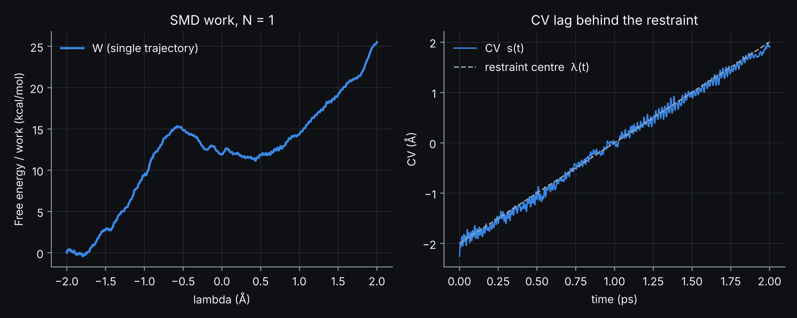

 
<h2> 
 <b>VIII - Steered QM/MM MD and the Jarzynski work profile</b> 
</h2>

 

<pre style="color: white; background-color: black;">
QMMM_MD_EQ-1.restart(.bin) + .wfn  ->  qmmm_md_smd.inp (moving restraint on the CV, 2 ps)  ->  QMMM_MD_SMD-COLVAR.metadynLog  ->  smd_jarzynski.py
</pre>

---

 

In steered MD a harmonic restraint on a collective variable (CV) is moved at constant speed, and the system is dragged from the reactant to the product along it. A single fast pull does not give a free energy, but it shows whether the QM/MM model can describe the reaction, which bonds form and break and in which order, and it gives the structures from which umbrella sampling windows can be started. The run and its analysis are in <a href="https://github.com/arvpinto/enzyme_qmmm_prep_cp2k/tree/main/qmmm_md_smd" target="_blank">qmmm_md_smd</a>.

 

<h3> 
<b> The collective variable </b>
 </h3>

 

<pre style="color: white; background-color: black;">
  &SUBSYS
    ...
    &COLVAR 1               ! CV1
      &DISTANCE_FUNCTION    ! CV = d(1-2) + COEFFICIENT*d(3-4)
        ATOMS 7699 7700 3607 7699 ! CV1 = d(O4-C1, glycosidic bond) - d(HE2(Glu232)-O4, proton transfer)
        COEFFICIENT -1.
      &END DISTANCE_FUNCTION
    &END COLVAR
  &END SUBSYS
</pre>

 

| Serial | Atom | Role |
| :--- | :--- | :--- |
| 7699 | O4 of 4GA500 | glycosidic oxygen: loses C1, gains a proton |
| 7700 | C1 of 4GA501 | anomeric carbon of the -1 sugar |
| 3607 | HE2 of GLH232 | proton of the general acid |

 

DISTANCE_FUNCTION combines two distances, CV = d(O4-C1) - d(HE2-O4). It is negative in the reactant (bond formed, proton on Glu232: -2.25 &Aring; at the end of Section VII) and positive when the glycosidic bond is broken and O4 is protonated (e.g. 3.0 - 1.0 = +2.0 &Aring;). A single CV that combines the bond that breaks and the bond that forms lets the system choose the timing of the two events. The attack of the nucleophile, Asp196 OD1 on C1 (3.1 &Aring; at the start), is not part of the CV: we follow it along the run.

 

---

 

<h3> 
<b> The moving restraint </b>
 </h3>

 

<pre style="color: white; background-color: black;">
&MOTION
  &CONSTRAINT
    &COLLECTIVE
      COLVAR 1
      INTERMOLECULAR TRUE
      TARGET [angstrom] -2.          ! value at t=0; set it close to the CV at the end of the NVT run
      TARGET_GROWTH [angstrom*fs^-1] .002  ! STEPS = (TARGET_LIMIT - TARGET)/TARGET_GROWTH/TIMESTEP
      TARGET_LIMIT [angstrom] 2.
      &RESTRAINT
        K [angstrom^-2*kcalmol] 100.0  ! restraint energy K*(CV-TARGET)^2
      &END RESTRAINT
    &END COLLECTIVE
  &END CONSTRAINT
  &FREE_ENERGY
    METHOD METADYN     ! no hills (DO_HILLS FALSE): only used to print the CV to QMMM_MD_SMD-COLVAR.metadynLog
    &METADYN
      DO_HILLS FALSE
      &METAVAR
        COLVAR 1
        SCALE .5
      &END METAVAR
      &PRINT
        &COLVAR
          COMMON_ITERATION_LEVELS 3
          &EACH
            MD 10
          &END EACH
        &END COLVAR
      &END PRINT
    &END METADYN
  &END FREE_ENERGY
  &MD
    ...
    STEPS 2000
    TIMESTEP 1.
    ...
  &END MD
  ...
&END MOTION

&EXT_RESTART
  BINARY_RESTART_FILE_NAME QMMM_MD_EQ-1.restart.bin
  RESTART_CELL
  RESTART_FILE_NAME QMMM_MD_EQ-1.restart
  RESTART_POS
  RESTART_QMMM
  RESTART_COUNTERS FALSE
  RESTART_THERMOSTAT
&END EXT_RESTART
</pre>

 

- 
&COLLECTIVE with a &RESTRAINT section turns the constraint into a harmonic restraint, U = K (CV - TARGET)2 (CP2K does not use the factor 1/2), with K = 100 kcal mol-1 &Aring;-2. TARGET starts at -2.0 &Aring; and grows by 0.002 &Aring; per fs (2 &Aring;/ps) until TARGET_LIMIT (+2.0 &Aring;), which takes the 2000 steps of 1 fs of the run. INTERMOLECULAR TRUE is needed because the atoms of the CV belong to different molecules (the protein and the oligosaccharide).

- 
TARGET should be close to the value of the CV at the start of the run, otherwise the first part of the pull is spent bringing the CV to the restraint. Here the CV starts at -2.25 &Aring;, 0.25 &Aring; below TARGET, and reaches the target within the first 20 fs. If you change the system or the equilibration, measure the CV at the end of the NVT run (Section VII) and set TARGET and STEPS accordingly.

- 
The &FREE_ENERGY section with DO_HILLS FALSE adds no bias: it is used only to print the CV every 10 MD steps to QMMM_MD_SMD-COLVAR.metadynLog (column 1 is the time in fs, column 2 the CV in bohr).

- 
The run continues the NVT simulation: positions, velocities (from the .bin file) and the thermostat are read from the restart files of Section VII, and the wavefunction from QMMM_MD_EQ-RESTART.wfn. RESTART_COUNTERS FALSE starts the step counter and the time at 0, which is what TARGET_GROWTH refers to.

 

---

 

<h3> 
<b> Running the steered MD </b>
 </h3>

 

In the working directory, after the NVT run (the input reads QMMM_MD_EQ-1.restart, QMMM_MD_EQ-1.restart.bin and QMMM_MD_EQ-RESTART.wfn):

<pre style="color: white; background-color: black;">
cp ../enzyme_qmmm_prep_cp2k/qmmm_md_smd/qmmm_md_smd.inp .
cp2k.psmp -i qmmm_md_smd.inp -o qmmm_md_smd.out
</pre>

 

The example took 5.8 h on 128 MPI ranks, with every SCF converged. During the run, follow the CV with the cp2k_colvar function, which converts it to &Aring;ngstr&ouml;m:

<pre style="color: white; background-color: black;">
source cp2k_funcs
cp2k_colvar QMMM_MD_SMD-COLVAR.metadynLog | sed -n '1,3p;$p'
#   time[fs] CV[angstrom]
       0.000     -2.25313
      10.000     -2.05654
    2000.000      1.95699
</pre>

 

After the first 50 fs the CV stays on average 0.07 &Aring; from the moving target: the restraint is in control throughout the pull. The temperature of the system stays at 299.8 &plusmn; 0.8 K.

 

---

 

<h3> 
<b> Watching the bonds form and break </b>
 </h3>

 

Download QMMM_MD_SMD-pos-1.dcd from the <a href="https://github.com/arvpinto/enzyme_qmmm_prep_cp2k/releases/latest" target="_blank">latest release</a> into the working directory if you did not run the steered MD. vmd_cp2k-repr.tcl draws the QM region with dynamic bonds, which are drawn only while two atoms are within the bonding distance, so bonds appear and disappear along the trajectory. The labels given with -bonds can be plotted from Graphics > Labels > Bonds > Graph; here they follow the two distances of the CV, the nucleophile and the water of the QM region:

<pre style="color: white; background-color: black;">
wget https://github.com/arvpinto/enzyme_qmmm_prep_cp2k/releases/latest/download/QMMM_MD_SMD-pos-1.dcd
vmd -e vmd_cp2k-repr.tcl -args amylase_ee.prmtop QMMM_MD_SMD-pos-1.dcd \
    -qminc forceeval_qmmm.cp2k.inc \
    -bonds "7699:7700 3607:7699 3026:7700 3607:7783 7785:7699"
</pre>

 

| Label | Distance | Start of the pull | End of the pull |
| :--- | :--- | ---: | ---: |
| 7699:7700 | O4(500)-C1(501), glycosidic bond | 1.48 &Aring; | 4.74 &Aring; |
| 3607:7699 | HE2(Glu232)-O4(500) | 3.73 &Aring; | 2.78 &Aring; |
| 3026:7700 | OD1(Asp196)-C1(501), nucleophilic attack | 3.13 &Aring; | 1.53 &Aring; |
| 3607:7783 | HE2(Glu232)-O(WAT511) | 1.68 &Aring; | 0.98 &Aring; |
| 7785:7699 | H2(WAT511)-O4(500) | 2.07 &Aring; | 0.99 &Aring; |

<i>Start: QMMM_MD_EQ-1.restart.bin; end: QMMM_MD_SMD-1.restart.bin.</i>

 

At the end of the pull the glycosylation step is complete, but not exactly as the CV describes it:

- 
the glycosidic bond is broken, and Asp196 OD1 is bonded to C1 (1.53 &Aring;): the covalent glycosyl-enzyme intermediate has formed, although the nucleophile is not in the CV. C1-O5 of the -1 sugar is 1.34 &Aring;, shorter than at the start (1.39 &Aring;);

- 
O4 is protonated, but not by HE2 of Glu232. At the start of the pull the water of the QM region already bridges the two (Glu232 HE2...OW 1.68 &Aring;, H2W...O4 2.07 &Aring;); at the end HE2 belongs to the water (0.98 &Aring;, Glu232 OE2-HE2 1.85 &Aring;) and one of the original water protons belongs to O4 (0.99 &Aring;). The proton went from Glu232 to O4 through WAT511, a Grotthuss-like relay.

Play the trajectory to see when each event happens (the bond lengths only tell us where the run ended). The relay has a consequence for the CV: it follows HE2, which never reaches O4 (2.78 &Aring; at the end), so once the proton has moved through the water the second term of the CV no longer describes the proton transfer, and the CV grows by stretching O4 away from C1 (4.74 &Aring;). This is a common pitfall of CVs defined on specific hydrogen atoms; a CV that does not depend on which proton arrives (e.g. a coordination number of O4 by hydrogens) avoids it. Watch also the conformation of the -1 sugar ring and the hydrogen bonds of Asp299 with its O2 and O3 hydroxyls.

 

---

 

<h3> 
<b> Work and free energy: the Jarzynski equality </b>
 </h3>

 

The work done by the moving restraint is W(t) = &int; &part;U/&part;&lambda; d&lambda;, with &lambda;(t) = TARGET + TARGET_GROWTH t and &part;U/&part;&lambda; = -2K (CV - &lambda;). The Jarzynski equality relates the work of N independent pulls to the free energy along &lambda;, F(&lambda;) = -kT ln &lt;exp(-W(&lambda;)/kT)&gt;. smd_jarzynski.py integrates the work from the metadynLog files, reads TARGET, TARGET_GROWTH, TARGET_LIMIT, K and the temperature from the echo of the input in the CP2K output (or from the command line), and computes the Jarzynski average, the second-order cumulant expansion, F = &lt;W&gt; - var(W)/2kT, and their bootstrap errors when there are several replicas:

<pre style="color: white; background-color: black;">
python3 smd_jarzynski.py -h
python3 smd_jarzynski.py -l QMMM_MD_SMD-COLVAR.metadynLog -o qmmm_md_smd.out
</pre>

<pre style="color: white; background-color: black;">
# TARGET = -3.779452  TARGET_GROWTH = 9.142058e-05  TARGET_LIMIT = 3.779452265771286  K = 4.462539e-02  T = 300.0 K
# K = 100.00 kcal/mol/Å^2 as used by CP2K (U = K (s-lambda)^2); equivalent k = 200.00 in the U = k/2 (s-lambda)^2 convention
# pulling speed = 2.000 Å/ps
# QMMM_MD_SMD-COLVAR.metadynLog: 201 points, final W = 26.09 kcal/mol
# NOTE: single trajectory -> F(lambda) = W(lambda), an upper bound that includes dissipation
# wrote smd_jarzynski.dat
# wrote smd_jarzynski.png (600 dpi)
</pre>

 

    

 

- 
The parameters are read in CP2K internal units (bohr and hartree); the script prints them back in &Aring; and kcal/mol as a check. The profile is plotted against &lambda;, the restraint center, which is the proper variable of the Jarzynski equality (--xaxis cv plots it against the CV, averaged over the replicas, instead). smd_jarzynski.dat has the time, &lambda;, the CV, the work, both estimators and their errors at every point of the COLVAR file; the figure is shown on screen and saved at 600 dpi (--no-show only saves it, --prefix changes the file names).

- 
With a single trajectory both estimators reduce to the work itself, an upper bound of the free energy that includes the dissipation of a fast pull. In the example, the work rises to 15.2 kcal/mol at &lambda; = -0.56 &Aring; (t = 0.72 ps), drops to 10.9 kcal/mol at &lambda; = +0.42 &Aring; (t = 1.21 ps) and then rises again to 26.1 kcal/mol at the end, as the restraint keeps stretching O4 away from C1 after the relay (see above). The first maximum should not be read as the barrier of glycosylation: the work of a single fast pull includes dissipation, so it overestimates the free energy at every &lambda;.

- 
For an actual free energy estimate, run several pulls with the same protocol from different starting points (e.g. frames of a longer NVT run, or new velocities), give all their metadynLog files to the script, and check that the Jarzynski and cumulant estimates agree within their bootstrap errors; slower pulls need fewer replicas. Umbrella sampling with windows started from frames of the steered MD is the usual alternative.

<pre style="color: white; background-color: black;">
python3 smd_jarzynski.py -l rep*/QMMM_MD_SMD-COLVAR.metadynLog -o rep1/qmmm_md_smd.out --nboot 500 --prefix smd_replicas
</pre>

 

---

 

<h3> 
<b> Where to go next </b>
 </h3>

 

- 
Repeat the pull from different frames of the NVT run, or more slowly, and combine the replicas with smd_jarzynski.py.

- 
Redefine the CV so that it does not depend on which proton reaches O4 (e.g. with a coordination number), or add the nucleophile distance as a second CV, and compare which events happen and in which order.

- 
Start umbrella sampling windows along the CV from frames of the steered MD (fixed TARGET, TARGET_GROWTH 0, the same restraint form) and combine them with WHAM or umbrella integration.

- 
Study the deglycosylation step, in which a water molecule activated by Glu232 hydrolyses the glycosyl-enzyme intermediate formed here.

- 
The <a href="https://arvpinto.github.io/enzyme_neb_cp2k/" target="_blank">TS search tutorial</a> shows how to locate and characterize transition states with static QM/MM calculations (CI-NEB and the dimer method) on structures like these.

 
